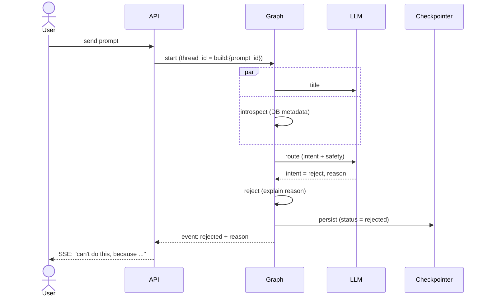
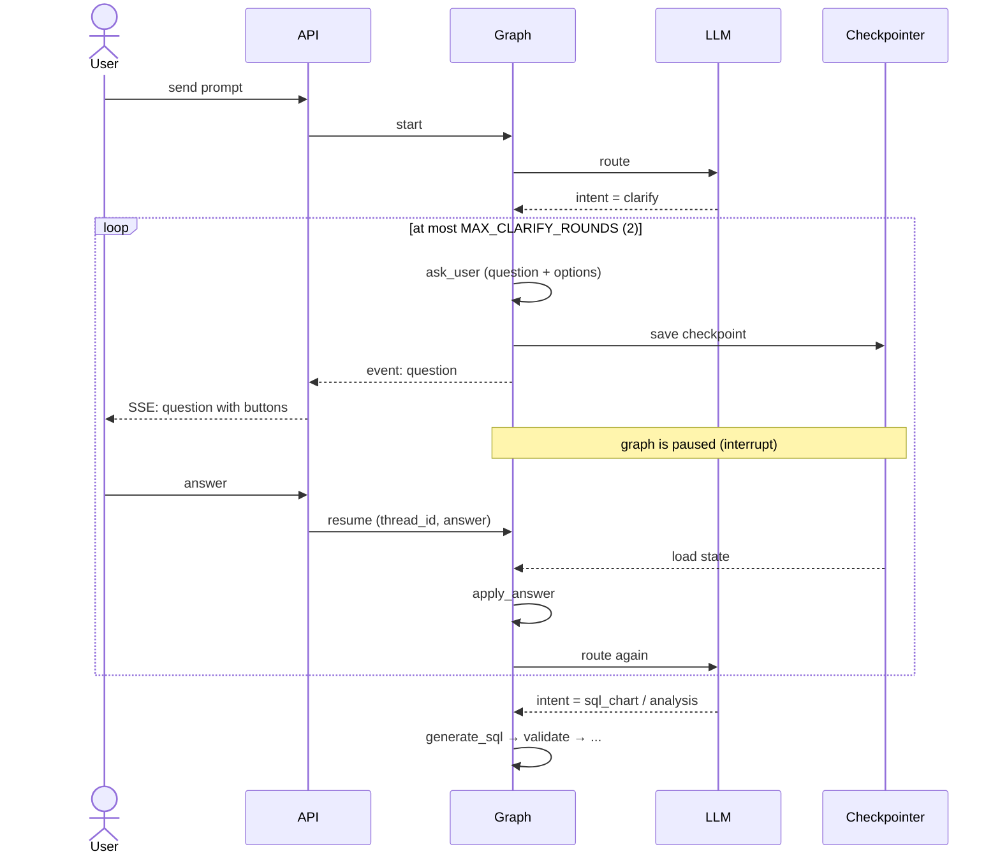
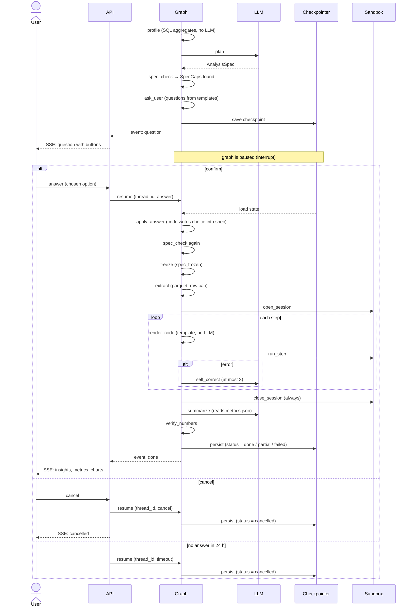

# Build graph: reject, ask_user, resume

Sequence diagrams for the zehn-analytics build graph (LangGraph).
They show what happens when a prompt is rejected, when the graph stops to ask the user,
and how it continues after the answer, a cancel or a timeout.

This is the **target** design. Today only the `sql_chart` nodes exist in code
(`title`, `introspect`, `generate_sql`, `validate`, `execute`, `normalize`, `map_chart`, `persist`).
Everything else is planned (status *Future* in IcePanel).

## Participants

| Name | What it is |
|---|---|
| User | Business user in the Frontend |
| API | FastAPI backend: starts the graph, streams events over SSE, receives answers |
| Graph | The single LangGraph build graph |
| Checkpointer | Postgres, keeps graph state between pause and resume (`thread_id = build:{prompt_id}`) |
| LLM | LLM API (route, plan, summarize) |
| Sandbox | Sandbox runner + container (gVisor) |

## Limits

| Constant | Value |
|---|---|
| `MAX_CLARIFY_ROUNDS` | 2 |
| `MAX_FIX_ATTEMPTS` | 3 |
| Answer timeout | 24 h, then status `cancelled` |

End statuses: `done`, `partial`, `failed`, `rejected`, `cancelled`.

---

## 1. Rejected prompt

`route` decides the prompt is unsafe or out of scope. No SQL is generated.

---

## 2. Clarify before SQL (route asks)

`route` finds the prompt unclear (e.g. `gross_revenue` or `net_revenue`?).
The graph stops, the user answers, `route` runs again. At most 2 rounds.

---

## 3. Analysis: confirm, cancel, timeout

After `plan`, code in `spec_check` finds gaps (target column, 40% nulls, ...).
The user confirms an option, cancels, or does not answer in 24 h.

---

## Rules to keep in mind

- On resume only the interrupted node runs again, so its code before the interrupt must be safe to repeat (idempotent).
- Re-plan only if the answer changes the goal. Re-profile only if the dataset changes.
- No questions inside the sandbox: all questions happen before `freeze`.
- `close_session` always runs, even after an error.
