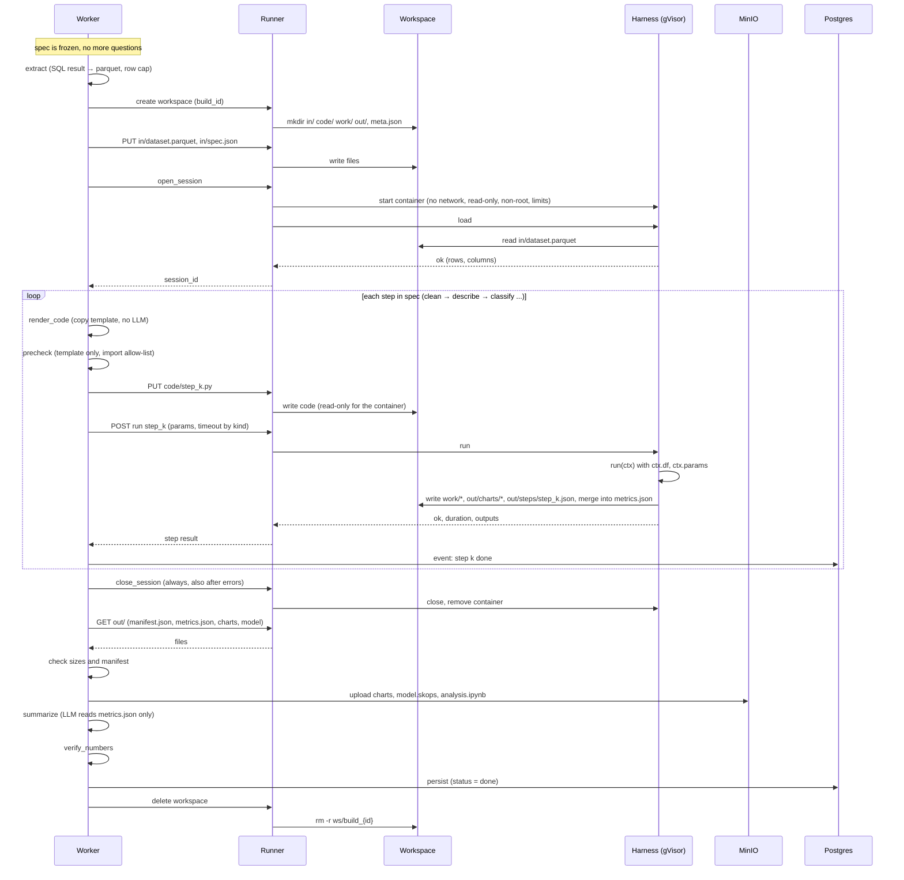
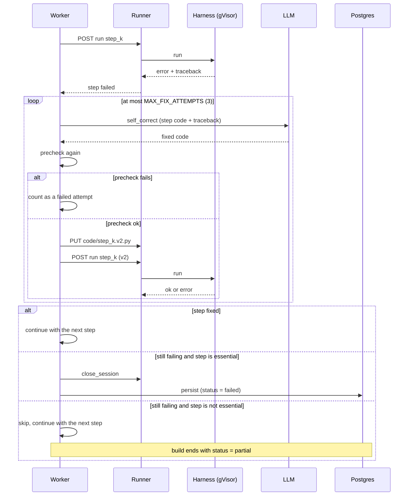
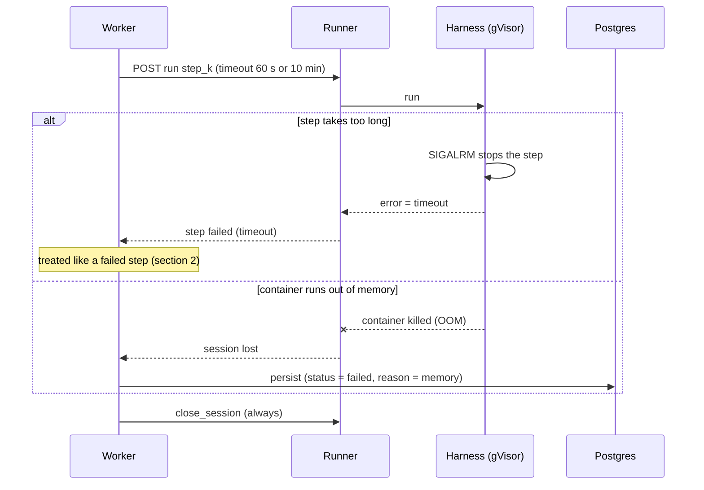
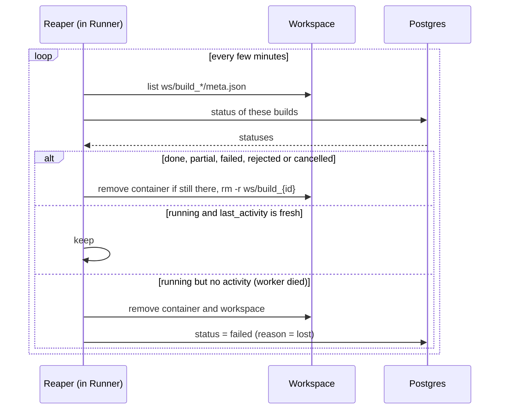

# Sandbox: running one analysis

Sequence diagrams for the sandbox part of the `analysis` path: from `extract` to `persist`.
Questions to the user are already over at this point (`freeze`), see [build-graph-hil.md](build-graph-hil.md).
Architecture and limits: [architecture.md](architecture.md), sections 5 and 9.

**Status:** prototype in `sandbox/` (zehn-analytics_backend). The prototype talks to the container with
`docker run -i` and JSON lines over stdin/stdout. The target is a runner service over HTTP on k3s with gVisor.
The diagrams show the target; the harness commands (`load`, `run`, `close`) are the same in both.

## Participants

| Name | What it is |
|---|---|
| Worker | Celery worker running the build graph |
| Runner | sandbox runner service: creates containers, moves files, sends commands; only the worker can call it (token) |
| WS | workspace on the host: `ws/build_{id}/` with `in/`, `code/`, `work/`, `out/`, `meta.json` |
| Harness | `harness.py` inside the container: loads data once, runs steps, writes results |
| LLM | LLM API (only `self_correct` and `summarize` here) |
| MinIO | storage for charts, models, notebooks |
| Postgres | build status and results |

## Harness commands

| Command | What it does |
|---|---|
| `{"op": "load"}` | reads `in/dataset.parquet` into memory, once per session |
| `{"op": "run", "step", "file", "params", "timeout"}` | runs `code/<file>`, calls `run(ctx)`, writes `out/steps/<step>.json` |
| `{"op": "close"}` | stops the harness |

---

## 1. Normal run

---

## 2. A step fails: self_correct

The LLM sees only this step's code and the trimmed traceback. The fixed code is saved as a new
version (`step_k.v2.py`) and must pass `precheck` again.

`MAX_LLM_CALLS = 8` covers the whole build: when the budget runs out, the build ends with `failed: budget`.

---

## 3. Timeout and out of memory

---

## 4. Cleanup

The reaper deletes workspaces by build status, not by a timer, so a build that is still running is never deleted.

---

## Rules

- No questions inside the sandbox. Everything the user decides is in `spec.json` before `open_session`.
- One container per build. The data is loaded once; each step runs on the in-memory data.
- The container gets only parquet: no DB credentials, no network, no secrets.
- Only `metrics.json` carries numbers out. `summarize` reads it and `verify_numbers` checks the summary against it.
- The container writes `out/`, so the worker does not trust it blindly: it checks the manifest and file sizes before upload.
- `meta.json` is outside the container's reach, so code in the sandbox cannot stop its own cleanup.

## Open questions

1. Timeout or out of memory: fail the step, or retry once on a smaller sample of the data?
2. How often the reaper runs, and after how long without activity a running build counts as lost.
